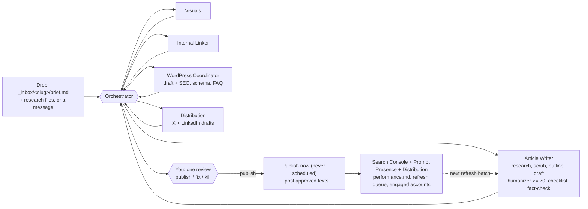

# Drop-in Content Pipeline for Grok Bot

Drop custom research, client notes, a transcript, or just a topic into a folder. A team of 8 Grok Bots does the rest:
- research and outline
- draft in your voice
- a humanizer gate
- a fact-check gate
- visuals and internal links
- a WordPress draft with SEO, schema and FAQ
- X and LinkedIn versions

You approve once. The post publishes in real time and the approved social texts go out. Then the pipeline measures itself: search, social, AI-answer citations and engaged accounts. It also tells you which old posts to refresh next.

It is built for the two ways AI-native content work is now hired:
- **Long-form AEO/SEO operator.** Answer-first articles at volume, batch refreshes from Search Console, a logged fact-check on every piece, and measured hands-on time.
- **Company-brain content engine.** Client work, call recordings and internal notes go in. Scrubbed case studies, articles, posts and distribution come out, all in one voice, with an engaged-executive list for growth and inbound conversations as the score.

## The proof
Real numbers from the original owner's site are in **RESULTS.md**:
- 2.5 hours from outline to live for a research pillar.
- 56 of 56 claims passed fact-check.
- Cited by Google AI Mode for 2 of 3 topic prompts on one article.
- Honest misses, too.

## How it flows

A failed gate stops the run and writes `HOLD.md` with the reason and options. You're told once, and your answer resumes it.

## What's in this package
| Path | What it is |
|---|---|
| `README.md` | This file |
| `SETUP-CHECKLIST.md` | Connectors, WordPress access, Search Console, folder setup, bot import order |
| `settings.example.md` | The ONE file for every owner-specific value: site, author, voice skill (default pipeline-voice), brand skill (default pipeline-brand), CTAs, banned phrases, price rule, gates, approval mode, bot IDs |
| `SOP.md` | The full process, reading its values from settings |
| `bots/01-08-*.md` | One brief per core bot: role, instructions with placeholders, skills, inputs, outputs, routines, access |
| `skills/content-pipeline-setup/SKILL.md` | First-run setup: asks your values, writes settings.md, voice.md and brand.md, checks access, runs a dry run |
| `skills/pipeline-voice/SKILL.md` | The default voice skill. Reads voice.md, runs the humanizer panel, enforces the G2 score gate |
| `skills/pipeline-brand/SKILL.md` | The default brand skill. Reads brand.md, renders featured, X and LinkedIn images and charts |
| `_templates/` | Blank article-folder files: status, time-log, factcheck, gates, review, hooks, links, outline, performance, refresh-queue |
| `_inbox/_TEMPLATE/brief.md` | The drop-in brief |
| `example-sample-article/` | One real article folder from the original owner, with private details removed |
| `RESULTS.md` | The proof, from real files only |
| `RELEASE.md` | How the bots are shared as Grok Bot templates (maintainer notes) |

## Get the bots
Open each link and import the bot. Start with the Orchestrator, because its first conversation runs setup.

| Bot | What it does | Template |
|---|---|---|
| Pipeline Orchestrator | Runs every drop from intake to your one review | [Import](https://x.ai/bot/W4PWU6QxU0n6_MGtCqeB0) |
| Article Writer | Research, outline, draft, humanizer and fact-check gates | [Import](https://x.ai/bot/IzSVXGMC0JuUm8l5JdLuY) |
| Visuals Studio | Featured, X and LinkedIn images and charts | [Import](https://x.ai/bot/zBQkMlszBMJQZAU5g6P5l) |
| Internal Linker | Links in and out of each new article | [Import](https://x.ai/bot/QTWmmCLApUckSFeo5qvny) |
| WordPress Coordinator | Builds and verifies the draft, publishes on approval | [Import](https://x.ai/bot/RxemIairdCX1FcwsYkaiY) |
| Distribution | X and LinkedIn posts in your voice | [Import](https://x.ai/bot/cwIvrz56zePknSMUMc7NH) |
| Search Console | Per-post search readback and weekly refresh list | [Import](https://x.ai/bot/_U4TyBnUF2iAT5pKUtvxz) |
| Prompt Presence Runner | 30-day AI-answer citation check | [Import](https://x.ai/bot/ZUoLMpIUrrD3of3o1okZ2) |

## Clone it in 6 steps
1. Work through `SETUP-CHECKLIST.md` sections A and B (accounts and sign-ins).
2. Import the 8 bots from the table above.
3. Copy this package's `_templates/`, `_inbox/` and `SOP.md` into your pipeline folder (default `/workspace/content-pipeline/`).
4. Tell the Orchestrator "set up the content pipeline". It asks for your values and writes `settings.md`, `voice.md` and `brand.md`.
5. Approve the routines you want (the inbox watch is optional).
6. Run the dry run, then drop your first real topic.

## Settings you'll probably change
- `approval_mode`: `final_only` (default, one review), `outline_and_final`, `every_step`, or `none` (auto-publish; not recommended).
- `social_on_approval`: `post` or `draft_only`.
- `voice_skill`: the one voice every piece is written in (default `pipeline-voice`).
- `brand_skill`: colors, type and image sizes (default `pipeline-brand`).
- `humanizer_min`, `max_rewrites`, `word_floor`.

## Limits to know
- WordPress only.
- Search Console runs through a signed-in browser unless you have a connector.
- AI-answer checks need a logged-out browser. Perplexity often walls logged-out sessions, and a signed-in ChatGPT can't be tested logged out. Results always say which engines ran.
- Video, newsletters, webinars and Telegram aren't automated yet.
