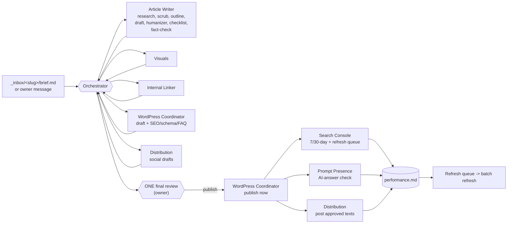

# Content Pipeline SOP (generic, v1.1)

Every value in `{braces}` comes from `settings.md` (see `settings.example.md`). Bots read settings.md before each job. Times use `{timezone}`.

## 1. What it does
It turns raw material into published, measured content: custom research, client work or company-brain notes, transcripts, or just a topic. The output is:
- a fact-checked long-form article
- visuals and charts
- internal links
- a WordPress post with SEO, schema and FAQ
- X and LinkedIn versions
- a measurement loop (search, social, AI-answer citations, engaged accounts, inbound)
- batch refreshes from search data

It is built for both kinds of AI-native content job:
- **The long-form AEO/SEO operator:** volume, refreshes, logged accuracy, measured hands-on time.
- **The company-brain content engine:** raw client work in, scrubbed stories and distribution out, all in one voice, measured in inbound conversations.

## 2. Roles (8 core bots + 1 optional)
| Role | Owns | Hands back to |
|---|---|---|
| Orchestrator | Detects drops, creates folders, sends every handoff, reads gates, holds or advances, sends the one final review, relays "publish" | Owner |
| Article Writer | Research normalize, scrub (G1), outline, hooks, draft, humanizer (G2), checklist (G3), fact-check (G4), refresh plans | Orchestrator |
| Visuals | Featured, X and LinkedIn images, charts from data.csv only, optional short video | Orchestrator |
| Internal Linker | links.md: outbound and inbound links, all HTTP 200, read-only access to the site | Orchestrator |
| WordPress Coordinator | The only bot that edits the CMS. Builds the draft, verifies SEO/schema/FAQ (G5), publishes in real time on approval, edits block by block | Orchestrator |
| Distribution | X hooks, X/LinkedIn texts and editor drafts, posts approved texts, social readback, engaged-accounts list | Orchestrator |
| Search Console | 7/30-day per-post readback, Monday site-wide refresh queue | Orchestrator, Article Writer (by file) |
| Prompt Presence | 30-day AI-answer citation check, states engines run | Orchestrator, Article Writer (by file) |
| Researcher (optional) | Deep studies: findings.md + data.csv | Orchestrator |

Only the Orchestrator decides "next". Only the WordPress Coordinator edits the CMS.



## 3. Folder layout
```
{pipeline_dir}/
  settings.md
  voice.md, brand.md
  SOP.md, README.md
  _templates/            status, time-log, factcheck, gates, review, hooks, links, outline, performance, refresh-queue
  _inbox/_TEMPLATE/brief.md
  _inbox/<slug>/         brief.md + research files (+ .claimed once started)
  _refresh/refresh-queue-<date>.md, _refresh/batch-<date>/
  _engagement/engaged-<date>.md
  <slug>/                inbox/ research/ outline.md hooks.md article.md scrub.md factcheck.md
                         time-log.md gates.md links.md images/ wp/ distribution/ review.md
                         performance.md status.md (HOLD.md only while held)
```

## 4. Drop-in run (default)
**Drop:** copy `_inbox/_TEMPLATE/` to `_inbox/<slug>/`, fill brief.md (only `topic` is required), add files, set `status: ready`. Or message the Orchestrator with the files.

**Detection:** a message to the Orchestrator starts it at once. A routine on the Orchestrator (`{inbox_watch_cron}`) lists ready briefs with no `.claimed` and ends silently if there are none. The Orchestrator writes `.claimed` first, so a drop never runs twice.

**Gates.** Each gate writes one `gates.md` line and one `time-log.md` row.

| Gate | Pass condition | On fail |
|---|---|---|
| G0 Intake | topic present; slug free; CTA known or `{default_cta}` | HOLD |
| Research | every number has a URL or file + date | under 3 sourced findings: HOLD |
| G1 Scrub (if `{scrub_client_details}`) | no client names, people, figures or `{scrub_terms}` left unless `public_ok` | HOLD |
| G2 Humanizer | voice panel Humanizer >= `{humanizer_min}`; first-pass score logged | rewrite up to `{max_rewrites}`, then HOLD |
| G3 Checklist | answer-first; >= `{word_floor}` words; CTA; no `{banned_phrases}`; price only per `{price_rule}` | one auto-fix, then HOLD |
| G4 Fact-check | every claim opened and matched; 0 FAIL | rewrite to source wording or cut, re-check once, then HOLD. **No CMS draft without PASS** |
| Visuals / links | charts only from data.csv; links HTTP 200 | drop the chart or link and note it |
| G5 CMS verify | title, meta, slug, featured + alt, schema, FAQ, CTA on preview | one retry, then HOLD |
| Social | exact texts saved as drafts | review goes without social, noted |

**One checkpoint (`approval_mode: final_only`).** The Orchestrator writes `review.md` and sends one message: preview, images, scores, fact-check FLAG fixes, inbound links, exact social texts and time so far. The owner replies:
- **publish**: real-time publish (never scheduled), a logged-out check, inbound links added, approved texts posted if `{social_on_approval}` = post.
- **publish, hold social**: publish only.
- **fix: ...**: the affected gates re-run and a new review goes out.
- **kill**: nothing is published.

**HOLD:** the gate owner writes `HOLD.md` (gate, what failed, what was tried, options). Nothing downstream runs. The owner is told once, and stale holds (> `{hold_stale_days}` days) are flagged. The owner's answer resumes the run from that gate.

**Approval modes:** `final_only` | `outline_and_final` | `every_step` | `none` (auto-publish when all gates pass; real-time, reported after; not recommended).

**Formats:** `article`, `case-study` (G1 required), `posts` (3-5 social posts, no CMS step), `repurpose` (transcript or recording to article + posts), `refresh`.

## 5. Manual entries
- **Owner-written draft:** save it as article.md and run G3, G4, then visuals, links, CMS and review. The fact-check is never skipped.
- **Research first:** Researcher output, then the same run.

## 6. After publish (automatic)
- **Search Console:** day 7 and day 30 per post. Every Monday it also writes `_refresh/refresh-queue-<date>.md`, ranking every post: position 5-20 with CTR under 2%, AI answers cite others, impressions falling, no FAQ/schema, or under the floor.
- **Distribution:** social readback at day 7 and 30. Weekly `_engagement/engaged-<date>.md` lists public accounts that engaged, for the growth handoff. No outreach.
- **Prompt Presence:** at day 30, 3-5 topic prompts. Always write "engines run: X of 3" with the session state per engine. Logged-out Perplexity often walls, and a signed-in ChatGPT can't test logged out. Never use the owner's signed-in sessions.
- **Inbound (if `{inbound_source}` set):** conversations that name or link a piece are logged in performance.md.

## 7. Batch refresh
The owner picks N posts from the refresh queue. Then:
1. Article Writer writes `_refresh/batch-<date>/batch.md`, a live snapshot per post, and a block-level `wp-edit-plan.md` (title/meta, answer-first lead, FAQ, sources, links).
2. G3 and G4 run on the changed text.
3. The owner gives one batch approval.
4. WordPress Coordinator edits block by block and verifies each post logged out.
5. A refresh baseline line goes in performance.md.

## 8. Time log and proof
Every step writes a time-log row: start, end, bot minutes, human minutes, what the human did, what the AI did. Unrecorded times are `unknown`, never estimated. The first-pass humanizer score is logged before any rewrite. These rows are the proof: draft-to-live time, first-pass rate, and human minutes per piece.

## 9. Standing rules
1. Nothing is published or posted without the approval `approval_mode` requires. Publishing is always real time.
2. Only the WordPress Coordinator edits the CMS, block by block. It never replaces a whole post body.
3. No invented numbers, sources or quotes. Charts only from data.csv.
4. `{banned_phrases}`, `{banned_punctuation}` and the `{price_rule}` apply to every word, image and post.
5. Client and company-brain material passes G1 before any draft.
6. One voice: everything is written with `{voice_skill}`. Multiple author voices are out of scope.
7. No passwords or keys in chat or files. Bots use the owner's connected accounts and browser sessions.
